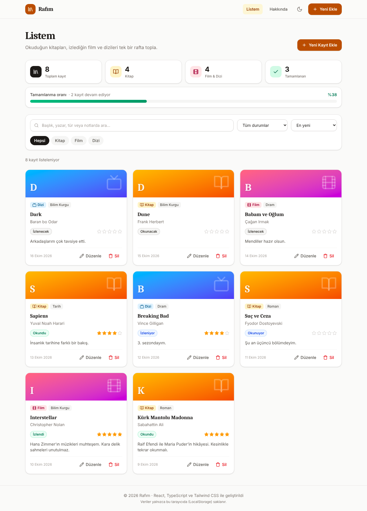
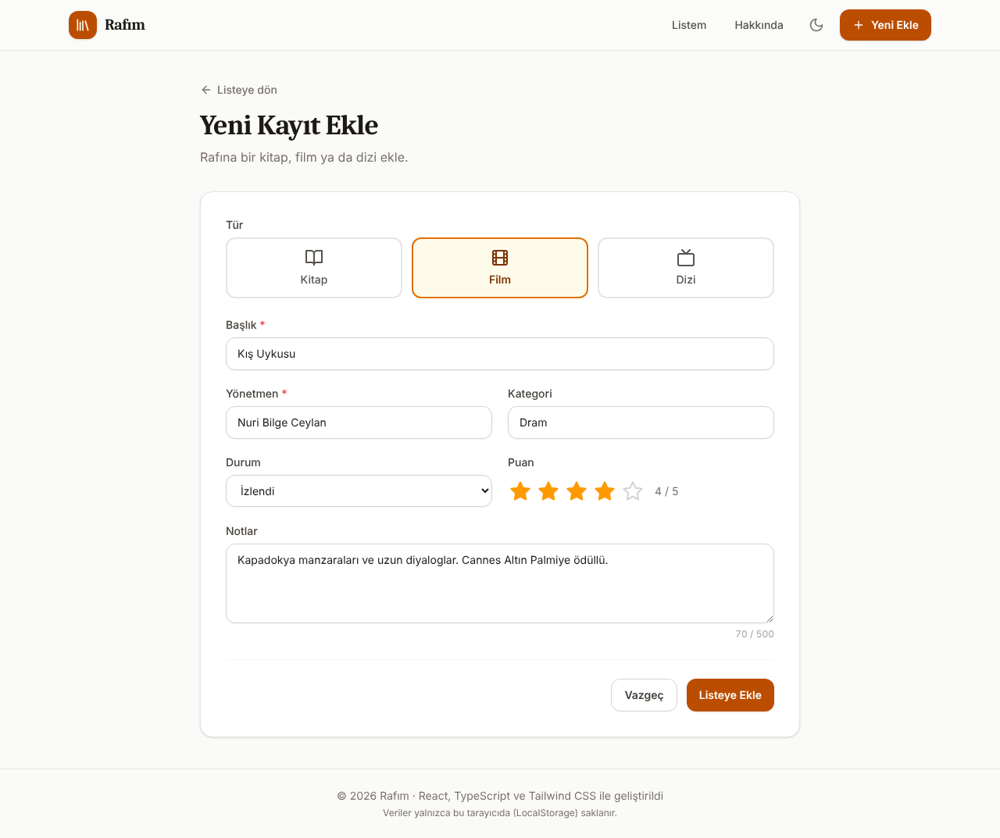
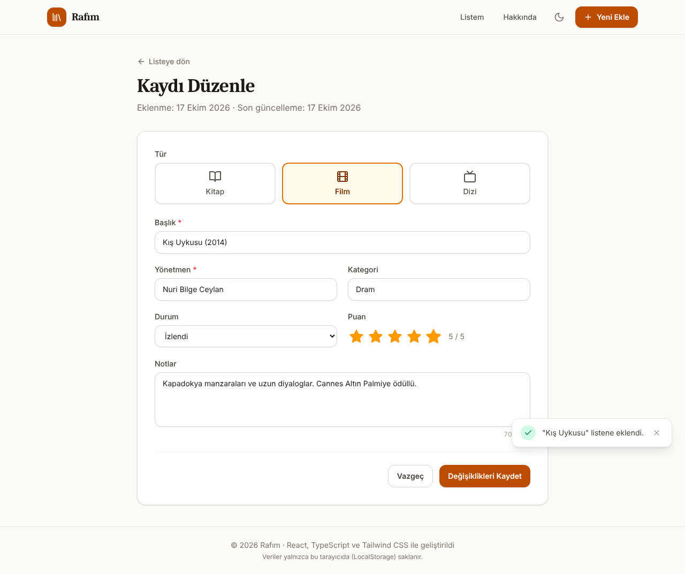
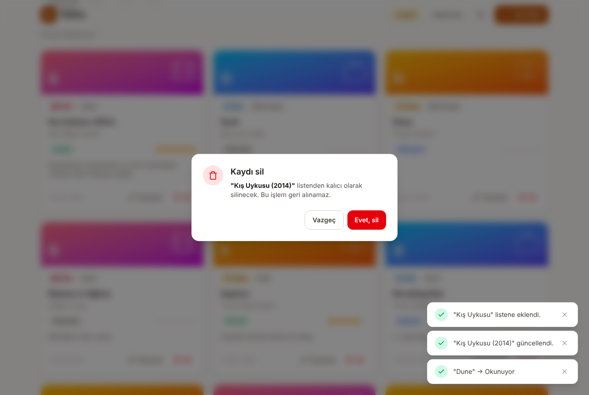
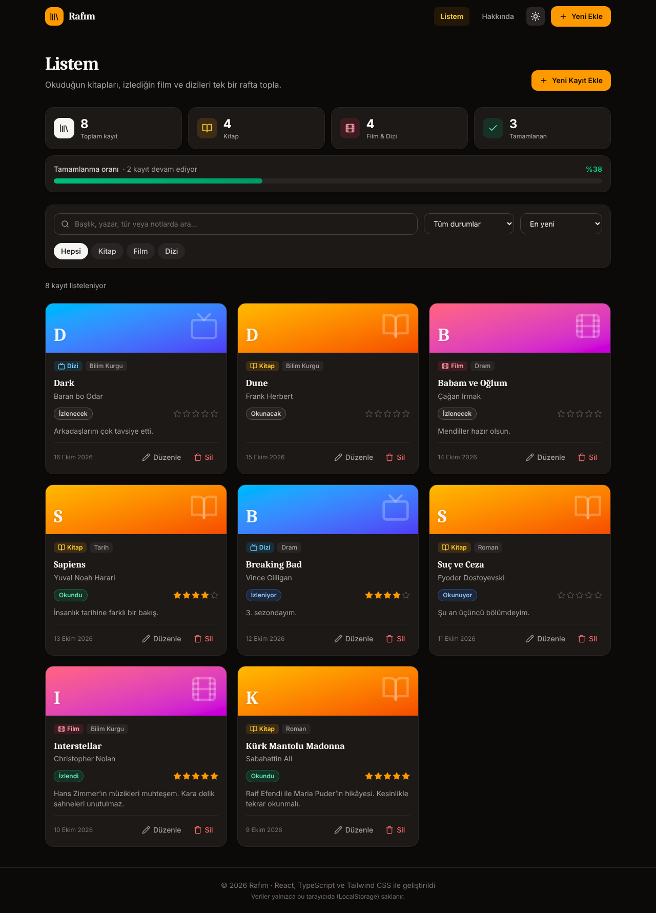
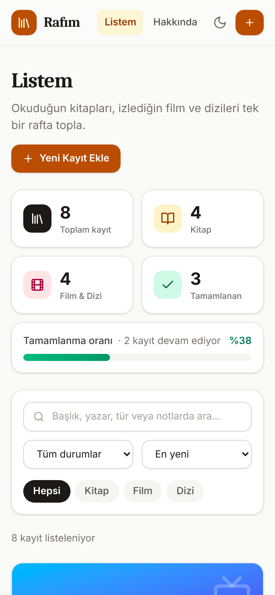

# Rafım – Okuma & İzleme Listesi

Okuduğun kitapları, izlediğin film ve dizileri tek bir rafta toplayan; **React**, **TypeScript** ve **Tailwind CSS** ile geliştirilmiş bir web uygulaması. Veriler tarayıcının **LocalStorage** alanında saklanır, sayfa yenilense de kaybolmaz.

> **Canlı demo:** _Netlify'a yükledikten sonra linki buraya ekle_ (örn. `https://rafim.netlify.app`)



## Özellikler

| İşlem | Nerede? | Açıklama |
| --- | --- | --- |
| **Ekle** (Create) | `Yeni Ekle` sayfası | Kitap / film / dizi ekleme formu. Başlık ve yazar/yönetmen alanları doğrulanır. |
| **Listele** (Read) | Ana sayfa | Kayıtlar kartlar halinde listelenir. Arama, tür ve durum filtresi, sıralama yapılabilir. |
| **Güncelle** (Update) | `Düzenle` sayfası | Kaydın tüm bilgileri değiştirilebilir. Karttaki durum rozetine tıklayınca durum hızlıca değişir (Okunacak → Okunuyor → Okundu). |
| **Sil** (Delete) | Kart üzerindeki `Sil` butonu | Onay penceresinden sonra kayıt kalıcı olarak silinir. |

Ek olarak:

- İstatistik kartları ve tamamlanma oranı çubuğu
- Türkçe karakterlere duyarsız arama (`kurk mantolu` → _Kürk Mantolu Madonna_)
- 1–5 yıldız puanlama ve not alanı
- Açık / koyu tema (tercih LocalStorage'da saklanır)
- İşlem sonrası bildirimler (toast)
- Mobil uyumlu (responsive) tasarım
- 404 sayfası ve ilk açılışta örnek veriler

## Ekran Görüntüleri

| Yeni kayıt ekleme | Kaydı düzenleme |
| --- | --- |
|  |  |

| Silme onayı | Koyu tema |
| --- | --- |
|  |  |

<p align="center"></p>

## Kullanılan Teknolojiler

- [React 19](https://react.dev) – arayüz kütüphanesi
- [TypeScript](https://www.typescriptlang.org) – tip güvenliği (`interfaces` klasörü)
- [Vite](https://vite.dev) – geliştirme sunucusu ve derleme aracı
- [Tailwind CSS 4](https://tailwindcss.com) – stil
- [React Router](https://reactrouter.com) – sayfa yönlendirme
- LocalStorage – verilerin tarayıcıda saklanması
- [Netlify](https://www.netlify.com) – yayın

## Klasör Yapısı

```
rafim/
├── public/
│   └── favicon.svg
├── screenshots/              # README ekran görüntüleri
├── src/
│   ├── components/           # Tekrar kullanılabilir bileşenler
│   │   ├── ConfirmDialog.tsx     # Silme onay penceresi
│   │   ├── EmptyState.tsx        # Boş liste / sonuç yok alanı
│   │   ├── FilterBar.tsx         # Arama, filtre ve sıralama
│   │   ├── Footer.tsx
│   │   ├── Icons.tsx             # SVG ikonlar
│   │   ├── ItemCard.tsx          # Listedeki her kayıt kartı
│   │   ├── ItemForm.tsx          # Ekle / Güncelle formu
│   │   ├── Layout.tsx            # Sayfa iskeleti
│   │   ├── Navbar.tsx            # Üst menü + tema butonu
│   │   ├── PageHeader.tsx
│   │   ├── StarRating.tsx        # Yıldız puanlama
│   │   └── StatsBar.tsx          # İstatistikler
│   ├── pages/                # Sayfalar (her biri bir adrese karşılık gelir)
│   │   ├── HomePage.tsx          # /            → Listele + Sil
│   │   ├── AddItemPage.tsx       # /ekle        → Ekle
│   │   ├── EditItemPage.tsx      # /duzenle/:id → Güncelle
│   │   ├── AboutPage.tsx         # /hakkinda
│   │   └── NotFoundPage.tsx      # 404
│   ├── interfaces/           # TypeScript arayüzleri (veri modelleri)
│   │   ├── MediaItem.ts
│   │   ├── Filters.ts
│   │   └── index.ts
│   ├── context/              # Global durum yönetimi
│   │   ├── ItemsContext.tsx      # CRUD fonksiyonları + LocalStorage
│   │   └── ToastContext.tsx      # Bildirimler
│   ├── hooks/
│   │   ├── useLocalStorage.ts
│   │   └── useTheme.ts
│   ├── utils/
│   │   ├── constants.ts          # Etiketler, renkler, sabitler
│   │   ├── helpers.ts            # Filtreleme, tarih, id üretimi
│   │   └── sampleData.ts         # Örnek veriler
│   ├── App.tsx               # Route tanımları
│   ├── main.tsx              # Giriş noktası
│   └── index.css             # Tailwind + ortak sınıflar
├── index.html
├── netlify.toml              # Netlify yayın ayarları
├── package.json
├── tsconfig*.json
└── vite.config.ts
```

## Kurulum ve Çalıştırma

Bilgisayarında [Node.js](https://nodejs.org) (20.19 veya üzeri, LTS sürüm önerilir) kurulu olmalıdır.

```bash
# 1. Bağımlılıkları yükle
npm install

# 2. Geliştirme sunucusunu başlat
npm run dev
```

Tarayıcıda `http://localhost:5173` adresini aç.

Diğer komutlar:

```bash
npm run build      # Yayın için dist/ klasörüne derler
npm run preview    # Derlenmiş hali yerelde önizler
npm run typecheck  # TypeScript tip kontrolü
```

## GitHub'a Yükleme

1. GitHub'da **New repository** ile `rafim` adında **Public** bir depo oluştur (README ekleme seçeneğini işaretleme).
2. Proje klasöründe terminali aç ve şu komutları çalıştır (`KULLANICI_ADIN` kısmını değiştir):

```bash
git init
git add .
git commit -m "Rafım: okuma & izleme listesi uygulaması"
git branch -M main
git remote add origin https://github.com/KULLANICI_ADIN/rafim.git
git push -u origin main
```

## Netlify ile Yayına Alma

1. [app.netlify.com](https://app.netlify.com) adresine GitHub hesabınla giriş yap.
2. **Add new site** (bazı arayüzlerde **Add new project**) → **Import an existing project** → **GitHub** seç ve `rafim` deposunu seç.
3. Ayarlar `netlify.toml` dosyasından otomatik gelir:
   - Build command: `npm run build`
   - Publish directory: `dist`
4. **Deploy** butonuna bas. Birkaç dakika sonra site `https://<proje-adı>.netlify.app` adresinde yayında olur.
5. **Site configuration → Change site name** ile adresi (ör. `rafim-ibrahim`) değiştirebilirsin.
6. Yayın linkini bu README'nin başındaki **Canlı demo** satırına ekle.

> `netlify.toml` içindeki yönlendirme kuralı sayesinde `/ekle` veya `/duzenle/...` sayfaları yenilendiğinde 404 hatası alınmaz.

## Proje Yönergesi Kontrol Listesi

- [x] Modern JavaScript kütüphanesi seçildi → **React** (LocalStorage kullanıldı)
- [x] Netlify ile yayına alınabilir bir çatı → **Vite + React**
- [x] `Components`, `Pages`, `Interfaces` klasörleri → `src/components`, `src/pages`, `src/interfaces`
- [x] CSS çatısı → **Tailwind CSS**
- [x] TODO App benzeri uygulama: **Ekle, Listele, Güncelle, Sil**
- [x] En az 1 ekran görüntüsü → `screenshots/` klasörü
- [ ] GitHub'da public depoya yükle
- [ ] GitHub linkini proje teslim formunda paylaş
- [ ] Netlify ile yayına al ve linki paylaş

## Geliştirici

**İbrahim Gürkan Kaya** – Web Geliştirme Eğitimi JavaScript Projesi
